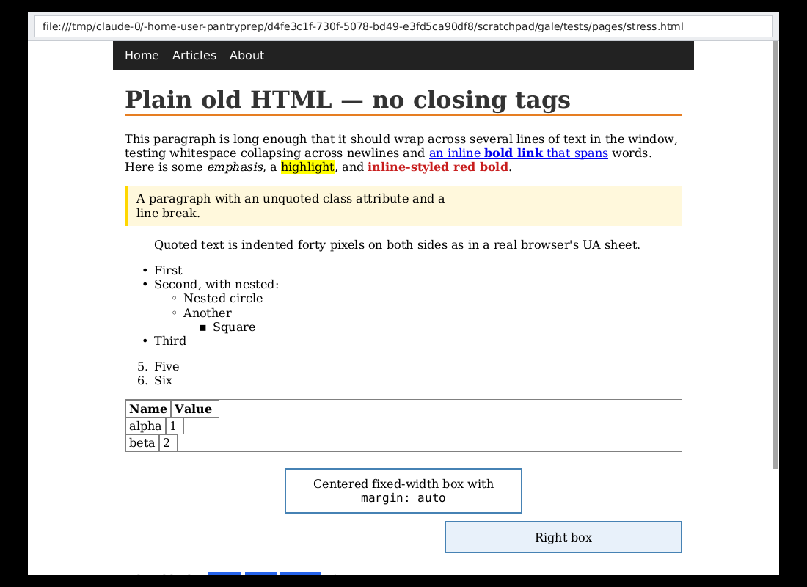

# Brickle Browser

A web browser engine written from scratch in Rust. It doesn't use Chromium, WebKit or Gecko: the
HTML parser, CSS engine, layout and rasterizer are all in `src/`.



## Principles

**No telemetry. No AI. No requests you didn't ask for.** See [PRIVACY.md](PRIVACY.md) for the
full rules and the tests that enforce them. In short, Brickle has:

- a **request panel** that lists every request a page makes; click any row to block or allow that host
- a built-in **content blocker** using EasyList, EasyPrivacy and uBlock Origin's lists
- **HTTPS-only** mode, with a warning before ever using plain HTTP
- **tracking-parameter stripping** (`utm_*`, `fbclid`, `gclid`, …)
- a **vanilla Firefox** browser name and headers, so it doesn't stand out
- each page parsed in a **sandboxed process**

## Run it

```sh
cargo run --release -- filters update       # download the filter lists (once, and whenever you like)
cargo run --release                         # opens the built-in home page
cargo run --release -- https://example.com  # open a URL
cargo run --release -- page.html            # open a local file
cargo run --release -- requests https://example.com   # list every request a page makes
cargo run --release -- render page.html -o page.png -w 1024   # headless full-page PNG
cargo run --release -- dom page.html        # dump the parsed DOM
cargo run --release -- sandbox-test         # check the renderer sandbox works on your kernel
```

Debugging flags: `--no-sandbox` runs everything in one process, and `--no-filters` skips the
filter lists and your rules.

**Linux Mint:** works out of the box on X11 (Cinnamon). If the build complains about missing
libraries, run `sudo apt install build-essential libxkbcommon-dev`.

**Controls:** the menu bar at the top (File, Edit, View, History) has everything below that
isn't scrolling or typing, with its shortcut beside it. `A−` / `A+` at its right change the text
size, and clicking the percentage between them goes back to the normal size.

| Action | Keys |
|---|---|
| Type a URL, or search DuckDuckGo | `Ctrl+L` or click the address bar, then `Enter` |
| Request panel | `F12`, `Ctrl+Shift+E`, or click "N blocked · M requests" |
| Scroll | mouse wheel, arrow keys, `Space`, `PgUp`/`PgDn` |
| Back / forward | the ← → buttons, `Backspace` or `Alt+←` / `Alt+→` |
| Reload / stop | the ↻ button (✕ while loading), `Ctrl+R` or `F5` / `Esc` |
| Bookmark this page (again to remove) / bookmarks toolbar | `Ctrl+D` / `Ctrl+Shift+B`; right-click a bookmark to remove it |
| Resize the request panel | drag its left edge |
| New tab / close tab / reopen closed tab | `Ctrl+T` or `+` / `Ctrl+W` or `×` / `Ctrl+Shift+T` |
| Switch tabs | `Ctrl+Tab`, `Ctrl+Shift+Tab`, `Ctrl+PgDn`/`PgUp`, `Ctrl+1`…`Ctrl+9` |
| Open a link in a new tab | middle-click, or `Ctrl`+click |
| Forms | click a field to type; `Tab` next field, `Enter` submit, `Esc` leave the field. In a field: arrows, `Home`/`End` move the caret (`Ctrl`: by words), `Shift` selects, `Ctrl+A` selects all. Click a drop-down to see its options; `↑`/`↓` change it |
| Find in page | `Ctrl+F`, then `Enter`/`Shift+Enter` (or `F3`, `Ctrl+G`) for the next/previous match, `Esc` to close |
| Select text | drag, double-click a word, `Ctrl+A` for the page, `Esc` to clear |
| Text size | `Ctrl+=` bigger, `Ctrl+-` smaller, `Ctrl+0` normal (125%, remembered between runs) |
| Interface size (menus, tabs, address bar, panels) | `Ctrl+Alt+=` bigger, `Ctrl+Alt+-` smaller, `Ctrl+Alt+0` normal, also in the View menu (remembered) |
| Light / dark interface (dark by default; pages keep their own colours) | `Ctrl+Shift+D`, or View menu (remembered) |
| Quit | `Ctrl+Q` |
| Copy / paste | `Ctrl+C` copies the selection (or the address, or what's selected in a form field; `Ctrl+X` cuts it); `Ctrl+V` or `Shift+Insert` pastes into the address bar or a form field |

## Architecture

```
 browser process (trusted)                     renderer process (sandboxed, one per page)
 ─────────────────────────                     ──────────────────────────────────────────
 window, address bar, history                  html.rs ─▶ dom.rs ─▶ style.rs ◀─ css.rs
 network.rs: rules, blocker, HTTPS ◀─ipc─▶                           │
 tab.rs: security policy, timeouts             layout.rs ─▶ draw ops ─▶ glyph atlas (skrifa)
 paint.rs: paints rects + glyph bitmaps
```

The browser fetches everything and enforces the security rules. Untrusted HTML and CSS are parsed
and laid out only in the renderer, which can't open files, use the network or run programs.
It sends back rectangles, pre-rasterized glyph bitmaps and decoded image pixels, which the
browser validates before painting.

| Module | What it does |
|---|---|
| `html.rs` | Tokenizer and tree builder. Handles implied end tags (`<p>`, `<li>`, `<td>`…), void elements, raw text (`<script>`/`<style>`), entities, and `<html>/<head>/<body>` normalization |
| `css.rs` | Rules, selectors (type, `.class`, `#id`, `*`, `[attr]`, `:root`, `:link`, descendant and `>` combinators, escaped names like Tailwind's `.md\:flex`), `@media` queries checked against the window (width, height, orientation, ranges, `not`/`or`), `::before`/`::after`, `!important`, colors, units, string escapes, custom properties (`--name`, `var()`) and `calc()`/`min()`/`max()`/`clamp()` |
| `style.rs` | Selector matching, specificity, the cascade (UA < author < inline), inheritance, shorthand expansion and computed values, and `::before`/`::after` boxes (`content` strings, `attr()`, quotes). The UA sheet is `ua.css` |
| `layout.rs` | Block and inline formatting contexts, box model, auto margins, `max-width`, margin collapsing between siblings, Unicode line breaking (UAX #14), `text-align`, `<pre>`, list markers, inline-blocks (baseline-aligned), flexbox (grow/shrink/basis, wrapping, `justify-content`, `align-items`/`align-self`/`align-content`, columns, `order`, gaps, `inline-flex`, auto margins), CSS grid (`grid-template-columns` with px/%/`fr`/`auto`/`minmax()`/`repeat()` including `auto-fill`/`auto-fit`, `grid-template-rows` and `grid-auto-rows` (`fr` rows when the grid has a height), `grid-column`/`grid-row`/`grid-area` lines and spans, `grid-template-areas`, gaps), `aspect-ratio`, percentage heights, floats (`float`, `clear`, `<br clear>`, `align=left/right`, with `overflow`/`flow-root` containing them), positioning (`relative`, `absolute`, `fixed`, insets, `z-index` stacking order), and tables (automatic column widths, `colspan`/`rowspan`, `border-spacing`, `vertical-align`, captions, CSS `display: table-*`) |
| `font.rs` | Bundled fonts, per-character fallback, lazy loading, and text shaping with [HarfRust](https://github.com/harfbuzz/harfrust) (in the renderer only): kerning, ligatures, Arabic joining, Indic conjuncts, combining marks, right-to-left words |
| `image.rs` | PNG, JPEG, GIF, WebP and SVG decoding (in the renderer only), with size checks before decoding, and resizing |
| `paint.rs` | Draw ops in CSS stacking order, clipped to `overflow` boxes (rectangles and images exactly, text by glyph), glyph-atlas rasterization (in the renderer: skrifa outlines, filled by `font.rs`), and the browser's software painter: alpha-blended rects and glyph bitmaps, cached in 512px tiles, painted on their own threads, so scrolling just copies pixels |
| `net.rs` | The only code that touches the network: single HTTP exchanges with Firefox's headers, decompression, URL helpers |
| `network.rs` | The network service: applies tracking stripping, your rules, the filter lists, HTTPS-only and redirect checks to every request, and keeps the request log |
| `filter.rs` | EasyList/uBlock filter engine: network rules, exceptions, options, cosmetic hiding, `$removeparam` |
| `lists.rs` | `brickle filters update` / `status` |
| `urlclean.rs` | Tracking-parameter stripping |
| `explain.rs` | What a request was for, in plain words, for the request panel: known trackers (a built-in table), what it carried, which list blocked it |
| `bookmarks.rs` | Your bookmarks, in a local file; nothing is fetched for them |
| `csp.rs` | Content Security Policy for pages' scripts (`script-src`, `connect-src` and friends), enforced in the renderer; never sends reports |
| `tab.rs` | Browser side of a page: spawns and supervises the renderer, answers its fetch requests |
| `renderer.rs` | The renderer process's message loop |
| `ipc.rs` | Length-limited binary protocol between the two. The browser treats every renderer message as hostile |
| `sandbox.rs` | Landlock + seccomp + rlimits for the renderer, and the `sandbox-test` probes |
| `gui.rs` | Browser window: address bar, scrolling, link hover and click, history |

Fonts: Liberation Sans, Serif and Mono 2.1.5 (Arial, Times New Roman and Courier New's letter
widths) and Inter 4.1 (for `system-ui`, Segoe UI, Roboto and similar), each in regular, bold, italic
and bold italic, unmodified, under the SIL Open Font License (`assets/fonts/LICENSE-Liberation.txt`,
`assets/fonts/LICENSE-Inter.txt`). Characters they lack come from DejaVu Sans
(`assets/fonts/LICENSE-DejaVu.txt`), then Noto subsets for Chinese, Japanese, Korean, Devanagari,
Thai, emoji and symbols, also under the OFL (`assets/fonts/fallback/OFL.txt`). Rebuild those with
`assets/fonts/fallback/build.sh`. Fonts other than regular and bold Sans and Serif are only parsed
when a page actually uses them.

## Security

JavaScript is off unless you allow a site; its requests go through the same rules as everything else, and scripts can't send anything to other sites unless you allow it. Cookies are first-party only and deleted on close unless you keep a site (see PRIVACY.md). Privacy protections are
described in [PRIVACY.md](PRIVACY.md). Security measures:

- **Sandboxed renderer (Linux).** Each page is parsed, laid out and its text rasterized in its own
  process, locked down with:
  - **namespaces** (where the system allows unprivileged user namespaces): its own network and
    IPC namespace, so there's no network to reach even past the other layers.
  - **Landlock:** no filesystem access, no TCP, no signals or abstract sockets outside the sandbox.
  - **seccomp-bpf:** a syscall allowlist, so `open`, `socket` and the like fail. `clone` can only
    create threads, memory can never be made executable, and attacker-only calls (`execve`,
    `ptrace`, `mount`, `bpf`, …) kill the renderer outright.
  - **rlimits:** 4 GB of memory and 120 s of CPU time.

  The browser only ever receives rectangles and finished glyph bitmaps from a renderer, and checks
  them (sizes, counts, references, and a per-region paint budget so it can't make every repaint
  crawl) before painting. It never runs the font rasterizer on anything
  a page controls: even a page's title reaches the tab bar as a bitmap its renderer drew (until it
  has one, the tab shows the site's host). It kills a renderer that hangs for 20 s or sends a malformed message, then
  shows an error page. Run `brickle sandbox-test` to see it block file reads, network and exec on your
  machine.
- **DNS over HTTPS.** Site lookups go to an encrypted resolver (Cloudflare by default, as in
  Firefox; `brickle dns` picks Wikimedia DNS or AdGuard instead), never in plain text to your
  network, unless you choose `brickle dns system`.
- **Revoked certificates are refused.** Brickle checks certificates against CRLite filters
  (Mozilla's revocation data, as in Firefox) on your own computer, so no certificate authority
  sees which sites you visit. `brickle filters update` downloads them along with the filter lists.
- **Web pages can't reach your local network.** A public website can't make Brickle send
  requests to your router, printer or other devices (`192.168.x.x`, `localhost`, …). This is
  checked after the DNS lookup, on the exact address Brickle connects to, so a site can't sneak
  past it by pointing its domain at your network (DNS rebinding). A link from a website to a
  local device asks first. (Through a proxy, the proxy does the DNS lookup, so only literal local
  addresses and names are caught.)
- **Web pages can't read your files.** A page loaded over `http(s)` can never load or link to
  `file://` URLs. The rule also covers reload, back and forward. Only `http`, `https` and `file`
  are supported at all.
- **Anti-spoofing address bar.** The real host is shown in bold and in punycode, so a lookalike
  like `аpple.com` shows as `xn--pple-43d.com`. `user@` prefixes are hidden, so
  `google.com@evil.com` shows as `evil.com`. Pages can't draw over the browser's own UI.
- **Resource limits against hostile pages:**
  - Responses and files up to 8 MB, 5 redirects, 20 s per request, text content types only
    (and images, for ``).
  - At most 300 images and 64 MB of them per page; images over 40 megapixels aren't decoded.
  - A page and its stylesheets get 30 s and 32 MB in total.
  - At most 16 external stylesheets and 5,000 rules per sheet.
  - Element nesting depth 256 and 100,000 nodes per page.
  - Selectors up to 32 parts and 8 levels of `:not()`/`:is()`/`:has()`, and matching has a
    step budget per page, so crafted selectors can't stall it.
  - Grid placement checks at most 4 million cells per grid, and generated `content` is at most
    1,000 characters per box.
  - Fonts capped at 256 px, and the glyph cache is bounded.
- **A slow or hostile page can't freeze the window.** Loading and layout run on a background
  thread and page tiles are painted on their own threads; `Esc` stops a load.
- **Background tabs let go of their renderer** after 10 minutes unused, or once more than 6 are
  live (longest-unused first), which ends their scripts and frees their memory. Switching back
  reloads the page.
- **No `unsafe` code** in Brickle itself (`#![forbid(unsafe_code)]`).
- **Fuzzed.** `fuzz/` has [cargo-fuzz](https://github.com/rust-fuzz/cargo-fuzz) targets for the
  HTML parser, the CSS parser, the whole render pipeline, the IPC decoder, the filter engine,
  JavaScript, the image decoders, text selection and find-in-page (on hostile text runs), CSS
  gradients and the address bar's text editing, and in the browser process what servers send:
  cookies, URLs and redirects, and raw HTTP responses (served from a local socket). CI fuzzes
  each one on every push. To run them locally: `cargo +nightly fuzz run html` (or `css`,
  `render`, `ipc`, `filter`, `js`, `image`, `select`, `gradient`, `lineedit`, `cookies`, `urls`,
  `response`).
- **Dependency auditing.** [cargo-deny](https://github.com/EmbarkStudios/cargo-deny) checks
  RustSec advisories, licenses and sources, and bans AI crates, in CI on every push and weekly
  (config in `deny.toml`). CI actions are pinned to commit hashes. Dependabot proposes updates,
  each waiting 7 days after release so hijacked releases have time to be caught.
- **Static analysis.** CodeQL scans the Rust code and the workflows, zizmor audits the CI
  workflows, and OpenSSF Scorecard rates the project's practices. Results are under the repo's
  Security tab.

- **Verifiable releases.** Release binaries are built only by GitHub Actions, with SHA-256 checksums
  and a signed build-provenance attestation:
  `gh attestation verify brickle-*-x86_64-linux.tar.gz --repo raztocky/gale`.
  Brickle never updates itself.

To report a vulnerability, see [SECURITY.md](SECURITY.md).

On non-Linux systems the sandbox isn't implemented yet, so you have to run with `--no-sandbox`.

## Not yet

JavaScript modules, the `grid-template`/`grid` shorthands, `grid-auto-flow` and named grid lines, CSS counters (`counter()` in `content` gives nothing), other pseudo-elements (`::marker`, `::first-line`…), scrolling inside boxes (boxes with `overflow: auto` grow to fit instead), file uploads, `:nth-child(… of S)`, conic gradients and multiple background layers, inline `<svg>` in HTML, animated images, choosing between conflicting collapsed table borders (cells' borders are drawn over the table's), `position: sticky` with `bottom`/`left`/`right` (only `top` sticks), relative offsets and vertical padding on inline elements, borders drawn around inline elements, web fonts (so icon-font characters in `content` are left out), the full Unicode bidi algorithm (runs of right-to-left words are mirrored within a line, but paragraphs stay left to right and `dir="rtl"` isn't applied), placing the caret or selecting in a form field with the mouse (clicking puts the caret at the end), and drop-down lists that reach outside a box that clips them.
